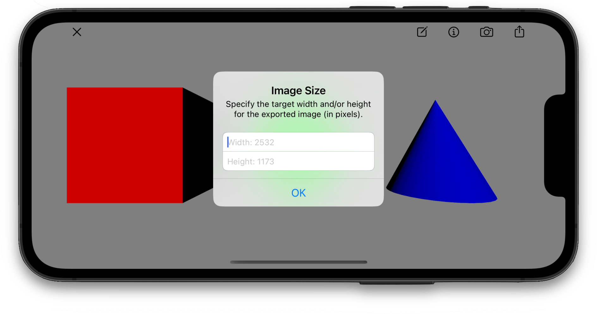

Export
---

Once you've finished crafting your 3D scene, you'll probably want to *do something* with it. For that you will need to use the *Export* feature.

**Export is a paid upgrade that can be unlocked via in-app purchase in the [ShapeScript iOS App](https://apps.apple.com/app/id1606439346). Export is not available in the free ShapesScript Viewer.**

To export your scene, select the export menu in the top-right of the window to unlock the export functionality. Once unlocked, this menu will display the export options.

**Note:** The export menu will be greyed out if the scene does not contain any exportable geometry.

## Model and Scene Formats

ShapeScript can export your scene in a variety of formats, selectable from the export window:

Extension             | File Type
:-------------------- | :-------------------------------
3mf                   | 3D Manufacturing Format
abc                   | Alembic
csg / scad            | OpenSCAD CSG
dae                   | COLLADA Digital Asset Exchange
obj                   | Wavefront Object
off / coff            | Object File Format
ply                   | Polygon File Format
scn / scnz            | SceneKit Scene
stl / stla            | Stereolithography
usd / usdz            | Universal Scene Description

 

**Note:** Not all formats support all features of ShapeScript scenes, so you may need to experiment. Some formats flatten the scene hierarchy into a single mesh, or strip elements such as cameras, lights and [materials](#colors-and-materials).

Exported models can be used in a variety of ways:

## Games and AR

Models exported from ShapeScript are well-suited to use in realtime 3D because the `detail` command gives you fine control over the triangle count. For realtime use you should generally set the detail level as low as you can get away with.

You can import Collada (DAE) or Wavefront (OBJ) files into a game development tool like Unity, or use USD(Z) files with Apple's SceneKit and RealityKit frameworks in Xcode.

## 3D Printing

ShapeScript can export models in the 3D Manufacturing Format (3MF) and Stereolithography (STL) format used by many 3D printing applications. Both binary and ASCII STL files are supported, but binary is recommended for file size and compatibility reasons. To export as ASCII use the `.stla` file extension, but note that you may need to rename the extension to `.stl` for it to be recognized by some applications.

When exporting for 3D printing, you will usually want to avoid having internal geometry inside the outer surface of your model. A good way to do this is to use the [union](csg.md#union) command to combine overlapping parts of your model into a single shape, eliminating internal faces.

You can also uses the [mesh](meshes.md) command to flatten a shape into a mesh without altering its geometry. This can be useful for ensuring that curves or text are preserved exactly when exporting with the OpenSCAD CSG format. It's also useful if you intend to use the CSG file with applications like FreeCAD that do not support all of the features.

ShapeScript scenes use the "Y-up" convention, where the Y-axis points up and the Z-axis points out from the screen. Some popular 3D printing applications such as [Cura](https://ultimaker.com/software/ultimaker-cura) use the "Z-up" convention instead. Check the "Convert to Z-Up" option in the export window to export your model in this orientation.

## Plotters and CNC Machines

Extension             | File Type
:-------------------- | :-------------------------------
svg                   | Scalable Vector Graphics

By selecting the SVG option, you can export your model as a 2D cross-section. Unlike the other model export formats, the SVG export option does not preserve any depth or material information, but simply takes a slice across the XY plane and captures a vector outline suitable for printing or carving by a [plotter](https://en.wikipedia.org/wiki/Plotter) or [CNC machine](https://en.wikipedia.org/wiki/Numerical_control).

## Image Formats

In addition to 3D models and 2D vector paths, ShapeScript can also export rendered 2D images of your scenes. By default, images will be captured using the current camera, but you can select a different [camera view](cameras.md) from the export window.

The following image export formats are supported:

Extension             | File Type                                         | Supports Transparency
:---------------------| :-------------------------------------------------|:------------------------------
gif                   | Graphics Interchange Format                       | Yes
png                   | Portable Network Graphics                         | Yes
jpg / jpeg            | Joint Photographic Experts Group                  | No
jpf / jp2             | JPEG 2000                                         | Yes
tif / tiff            | Tagged Image File Format                          | Yes
bmp                   | Bitmap                                            | No

 

If you aren't sure which format to use, the PNG format is a good all-rounder, with lossless compression and transparency support.

## Image Options

The size of the exported image defaults to the current window size at the current display resolution. You can override this size in your script file by adding `width` and/or `height` options to your [custom camera](cameras.md#pixel-dimensions), or by tapping on the size label in the export menu and selecting a different size:

Images are exported with a transparent background by default if the selected format supports it, or white otherwise. To change the background color or set a background image, you can use the [background command](commands.md#background). If you are planning to composite the image onto a different background later, you may wish to disable [antialiasing](cameras.md#antialiasing).

When exporting an image (or exporting a model for non-realtime use) you can improve the quality by using the [detail command](options.md#detail). A detail level of 100 should be good enough for even a very large or high-resolution image, but this can take a long time to generate/render.

The [preview](debugging.md#preview) symbol is `false` during export, so you can use this to specify different detail settings for editing and final output.

**Note:** Although ShapeScript can export images, for best results you should export as a 3D model and then import that into a [ray tracing](https://en.wikipedia.org/wiki/Ray_tracing_(graphics)) program that provides fine-grained control over scene lighting and camera placement.

## Colors and Materials

ShapeScript scenes can contain colors, textures and [materials](materials.md), but these cannot be faithfully represented in all formats.

Some formats do not support embedding geometry and textures or materials in a single file, in which case ShapeScript will export a folder containing the model and associated assets as separate files.

ShapeScript uses the [sRGB color convention](materials.md#color-representation) for numeric RGB, HSB, named, and hexadecimal colors. File conversion depends on the destination format:

- **CSG/SCAD:** RGB and alpha values are preserved numerically, matching OpenSCAD's numeric, named, and hex color conventions.
- **3MF:** Solid colors use sRGB hexadecimal bytes, rounded to the nearest integer. A color group's alpha alone does not specify a translucent printed material - that requires additional material properties. Texture images retain their embedded profiles.
- **DAE:** Exports static COLLADA XML with scene hierarchy, perspective and orthographic cameras, lights, sRGB material and vertex colors, vertex alpha, normals, texture coordinates, and diffuse, emission, and opacity textures. Normal maps, PBR material properties, shadows, and camera background/render settings are omitted. Spotlight penumbra is approximated. Textured exports use a folder containing the `.dae` file and its images.
- **ABC:** Export preserves geometry but does not preserve material colors, vertex colors or textures.
- **STL:** Binary color extensions have no declared color space. Components are preserved, with 5-bit facet quantization. ASCII STL has no color support.
- **USD:** Material colors are written as linear RGB. Textures keep their own encoding.
- **OBJ:** Exports sRGB material and vertex RGB. The vertex-color extension does not preserve vertex alpha.
- **OFF/COFF:** Both preserve face colors and alpha. `.off` exports always use an OFF header and omit vertex colors; choose `.coff` to preserve vertex RGB and alpha with a COFF header. Color components use ShapeScript’s sRGB convention without gamma conversion, as OFF does not declare a color space. Normals, texture coordinates and texture images are not preserved. Imports accept either header with either extension.
- **PLY:** Supports sRGB vertex colors and alpha, including scalar material tint, but does not embed textures.
- **USD:** Export preserves vertex colors and alpha by baking them into textures. Color, opacity, normal, roughness, metalness and emission textures share the same UV layout, preserving their alignment when reimported. Baking can reduce fine texture detail, and vertex colors are no longer editable as vertex data. Material shading may also differ between ShapeScript and a USD PBR renderer.
- **SVG:** Export creates a cross-section with fixed black outlines and a light-gray fill. It does not preserve the model's material colors.
- **Images:** Rendered images use their image color profiles. The software renderer tags its component values as sRGB.

Cross-application color and material fidelity depend on the exporters and receiving applications. A successful export does not imply every material feature was preserved. Readers that assume a different color convention can produce different results.

The [3MF materials specification](https://github.com/3MFConsortium/spec_materials/blob/master/3MF%20Materials%20Extension.md) defines sRGB colors, rounding, and material-layer behavior. The [OpenUSD color guide](https://openusd.org/25.11/user_guides/color_user_guide.html) defines linear Rec.709 as the default color space. STL's incompatible color extensions are described in the [Library of Congress format notes](https://www.loc.gov/preservation/digital/formats/fdd/fdd000505.shtml).

---
[Index](index.md) | Next: [Command Line Tool](cli.md)
