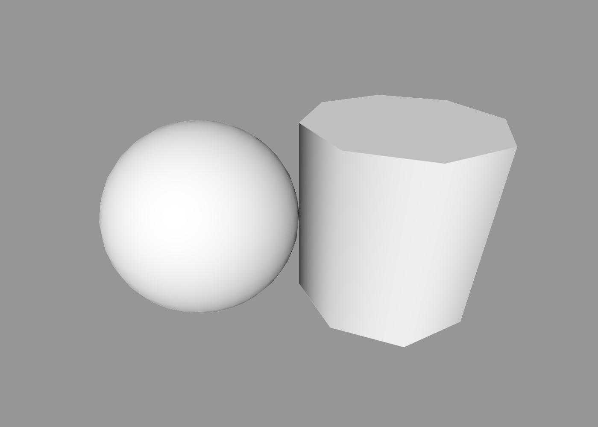
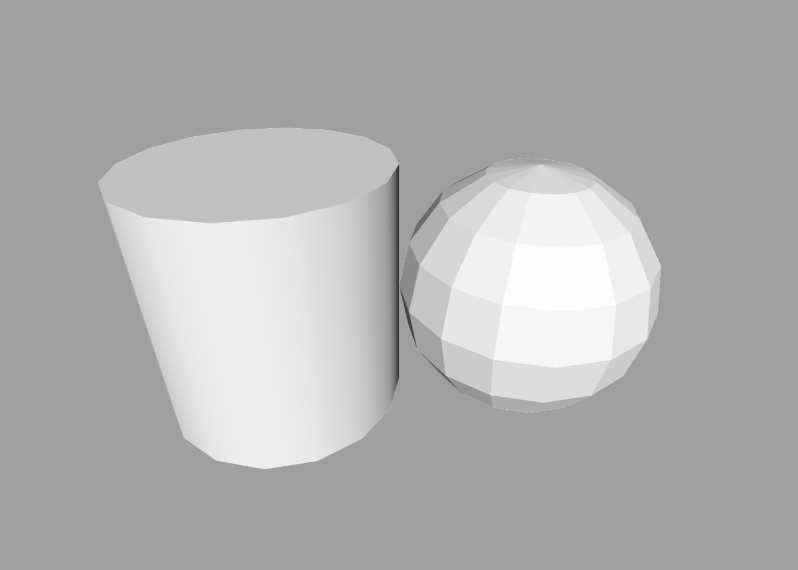

Options
---

All 3D shapes in ShapeScript have a common set of options that you can configure. As implied by the name, options are *optional* - they always have sensible default values that will be used if you don't specify a value.

Some shapes have extra options, specific to that shape. Later you will learn how to define custom options on your own shapes using the [option command](blocks.md#options).

An option is denoted by a name followed by one or more values or expressions inside a shape [block](blocks.md). Different options accept different value types, but typically these will be a number, vector or text. Here are some examples:

```swift
cube {
    detail 5 // a numeric value
    position 1 0 -1 // a vector value
    texture "Earth.png" // a texture value
}
```

## Script Options

You can also use the `option` command at the top level of a `.shape` file to define script options. These work like [custom block options](blocks.md#options), but apply to the whole script rather than a single block.

```swift
option radius 1
option color #ff0000

sphere {
    size radius
    color color
}
```

Each script option must have a default value. The default value is used when no override is supplied, and it also determines the type of value that the option accepts. For example, `option radius 1` expects a number, while `option color #ff0000` expects a color.

Script options can be overridden when running a file from the [command-line tool](cli.md), or when importing one ShapeScript file from another (see [import options](import.md#import-options)).

## Name

The `name` option assigns a name to a shape, path, or group, for example:

```swift
cylinder {
    name "Wheel"
    size 1 1 0.1
}
```

The name can contain spaces or punctuation, and is wrapped in double quotes to prevent ambiguity with other symbols (see [literals](literals.md) for details).

Names can be useful for identifying distinct shape components when [selecting them](getting-started.md#debugging-and-selection) in the viewer. They can also be used when importing a file using a fragment, such as `import "Vehicle.shape#Wheel"`. See [named geometry imports](import.md#named-geometry) for details.

## Detail

As discussed in the [getting started](getting-started.md) and [primitives](primitives.md) sections, curved shapes cannot be represented exactly using triangles, so they must be approximated to a specified level of detail.

ShapeScript allows you to configure that detail setting using the `detail` command:

```swift
sphere { detail 32 }
```

Unlike `name`, `detail` is not actually an option, but a global command. You can change detail level at any point within your ShapeScript file, and it will affect all shapes defined subsequently up to the end of the current [scope](scope.md).

The detail level can be overridden hierarchically, so a `detail` command inside a shape will take precedence over a `detail` command in its containing scope:

```swift
detail 8

sphere { detail 32 } // has detail of 32

cylinder { position 1 } // has detail of 8
```



The `detail` command accepts a single integer value, which represents the number of straight sections used to approximate a circle. This is directly applicable to shapes that have circular sections, such as a sphere or cylinder, as well as to circular [paths](paths.md).

For curved shapes that are not circular, such as a custom [path](paths.md), the relationship between the `detail` value and the number of sections is not quite so straightforward, but typically 1/4 of the `detail` value will be applied to each curved section of the path.

For expensive shapes or scenes, you can combine `detail` with the [preview](debugging.md#preview) symbol to use a lower detail level while viewing the scene, and a higher detail level when exporting:

```swift
detail if preview 8 else 64
```

## Smoothing

Similar to `detail`, `smoothing` is used to control the appearance of curved shapes.

As mentioned above, all shapes in ShapeScript are formed from flat triangles. To create the illusion of a curved surface, lighting can be smoothly interpolated across polygon faces to give the appearance of curvature. Lighting is calculated using [surface normals](https://en.wikipedia.org/wiki/Normal_(geometry)) - vectors  pointing outwards from each [vertex](https://en.wikipedia.org/wiki/Vertex_(geometry)) in a mesh that are used to indicate when the simulated curvature differs from the geometric reality.

[Primitive shapes](primitives.md) in ShapeScript all have appropriate normals set by default, and when creating [paths](paths.md) you can use the `curve` command to specify when a corner should appear curved rather than sharp. However, there are times when you may wish to override the default behavior, e.g. to deliberately create a more angular appearance, or to smooth an [imported](import.md) model that does not already include appropriate surface normal data.

The `smoothing` command accepts a numeric value in the range 0 to 1. This represents an angle between 0 and 180 degrees (see the [trigonometry section](functions.md#trigonometry) for more about how angles are represented in ShapeScript). This angle is the threshold at which ShapeScript will apply normal-based smoothing. Edges that meet at a greater angle than this threshold will be rendered as a sharp seam, and those that meet at lesser angle will appear as a smooth curve.

On that basis, a `smoothing` value of 0 means all edges will appear sharp. A value of 1 means all edges will appear rounded (this may look a little strange). A value of 0.5 (90 degrees) means that [obtuse](https://en.wikipedia.org/wiki/Angle#Types_of_angles) edges will appear rounded and acute ones will appear sharp.

Like `detail`, `smoothing` is a global option that applies hierarchically. You set it once at the top of the file, individually inside each shape, or any combination:

```swift
smoothing 0 // flat shading

cylinder { smoothing 0.5 } // smooth shading

sphere { position 1 } // inherits flat-shading from file scope
```



## Transform

Every shape has a position, orientation and size in space. Collectively, these are known as the shape's *transform*, and they can be set using the following options:

- `position x y z`
- `orientation roll yaw pitch`
- `size width height depth`

For more information on how these are used, see the [transforms](transforms.md) section.

## Material

You can set the color and texture of a shape (collectively known as its *material*) by using the `color` and `texture` options. Like `detail`, `color` and `texture` are not actually options, but global commands that can be set anywhere in your ShapeScript file and will apply to all subsequent shapes within the current [scope](scope.md).

For more information about materials, see the [materials](materials.md) section.

---
[Index](index.md) | Next: [Materials](materials.md)
